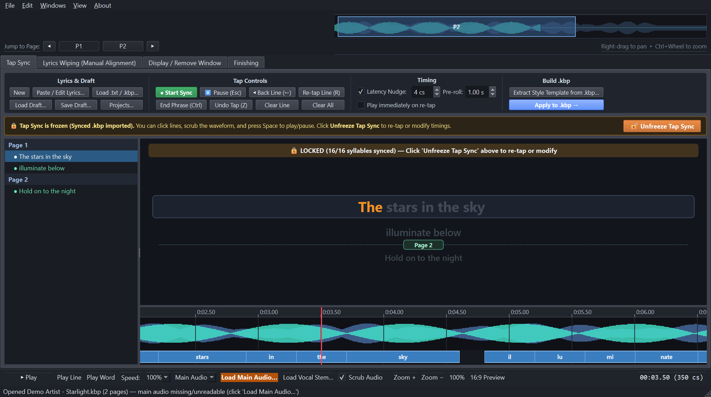
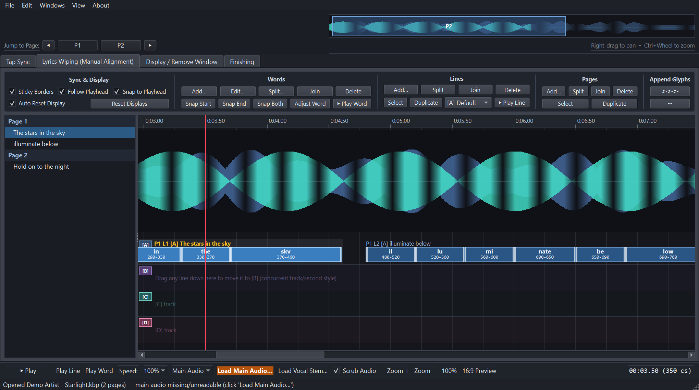
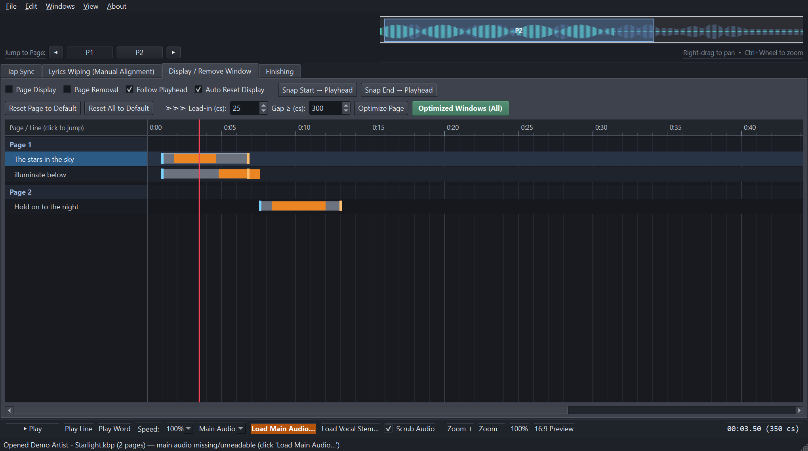
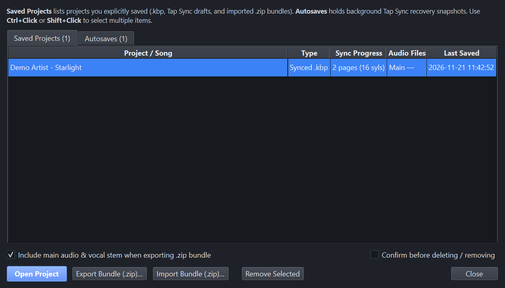

# Matt Joy Karaoke Builder

**A modern, dark-mode karaoke lyric tap-syncing, syllable wiping, and display-window editor for Karaoke Builder Studio (`.kbp`) projects.**

> **Status:** `v1.1.2` — Created by **Matt Joy** ([GitHub](https://github.com/MattJoyKaraoke))

---

## Screenshots

### Tap Sync (Rolling Teleprompter + Live Lookahead Waveform)


### Lyrics Wiping (Manual Syllable & Word Alignment)


### Display / Remove Window Editor


### Project Organizer (Saved Projects, Autosaves & Portable `.zip` Bundles)


---

## Key Features

### 1. Tap Sync (`Tap Sync` Tab)
- **KBS-Style Tap-to-Sync:** Hold & release `Space` (or tap `Ctrl` / `↓` / Right-Click) to sync syllables in real time with configurable **Latency Nudge** and **Pre-roll**.
- **Rolling Cross-Page Teleprompter:** Always shows upcoming lines across page breaks so you're never blindsided by a sudden page flip.
- **Live Lookahead Waveform:** 60 fps scrolling waveform with overlaid **Main Audio** + **Vocal Stem** tracks and live syllable blocks.
- **Single-Line Punch-In & Back Line:** Press `R` to re-tap just the selected line, or `←` to step back and re-sync continuously.
- **Freeze / Unfreeze Protection:** Completed or imported synced `.kbp` files automatically freeze Tap Sync so you can't accidentally overwrite finished timings—click **Unfreeze Tap Sync** anytime to re-tap a section and apply changes back to your `.kbp`.
- **Style Template Extraction:** Copy fonts, palette colors, and styles from any existing `.kbp` template.

### 2. Lyrics Wiping (`Lyrics Wiping` Tab)
- **Precision Waveform Timeline:** Dual-layer waveform rendering (Main Audio + isolated Vocal Stem) with smooth 60 fps playhead interpolation, `50% / 75% / 100%` playback speeds, and optional low-latency **Scrub Audio**.
- **Word Adjust Mode (`Enter`):** Focus on individual words/syllables, play single words or lines, nudge borders (sticky or non-sticky), split/join syllables, insert/delete syllables, and duplicate lines/pages into alternate styles (`A → B → C`).
- **0 cs Flush Borders & Auto-Repair:** Automatically repairs non-conforming `.kbp` timing issues on load (creating an untouched `.bak` backup first) and flushes stray 1 cs gaps.
- **Unlimited Undo / Redo:** Full snapshot undo/redo history (`Ctrl+Z` / `Ctrl+Y`).

### 3. Display / Remove Window (`Display / Remove Window` Tab)
- **Visual Page & Line Window Editor:** Inspect and adjust when each page and line appears and clears on screen.
- **One-Click Optimization:** Reset windows to defaults or run **Optimized Windows** (including lead-in glyph `➣➣➣` awareness and auto-reset mode).
- **Floating 16:9 Live Preview (`F9`):** Frameless, draggable, resizable karaoke preview window that updates live as you scrub or edit.

### 4. Multi-Window & Project Organizer
- **Native Multi-Instance Support:** Opening a `.kbp` or draft while a project is already open automatically launches a fresh window (`File → New Window` / `Ctrl+Shift+N`).
- **Unified Project Organizer:** Separates **Saved Projects** (explicitly saved `.kbp` files, Tap Sync drafts, and imported bundles) from background **Autosaves**, with **Ctrl+Click / Shift+Click** multi-select deletion and portable **`.zip` project bundle** export/import (including optional main audio & vocal stem).
- **Unsaved Change Protection:** Tracks edits across both Tap Sync and Lyrics Wiping / Display and prompts **Save / Discard / Cancel** before closing.

### 5. Finishing (`Finishing` Tab)
- **One-Click `.kbp` → `.ass` Conversion:** Converts the active synced project directly to an Advanced SubStation Alpha (`.ass`) subtitle file via `kbputils` (automatically saved beside the `.kbp` file with the same name).

---

## Getting Started

### Requirements
- **Python 3.11+** (tested on Python 3.13, Windows)
- Dependencies listed in [`requirements.txt`](requirements.txt): `PySide6`, `numpy`, `soundfile`, `kbputils`

### Installation & Running from Source
```powershell
git clone https://github.com/MattJoyKaraoke/Advanced-KBP-Editor.git
cd Advanced-KBP-Editor
python -m venv venv
.\venv\Scripts\pip install -r requirements.txt
.\venv\Scripts\python main.py
```

On Windows, you can also launch directly using [`run.bat`](run.bat) (or drop a `.kbp` file onto `run.bat` / the app window).

### Running Tests
```powershell
.\venv\Scripts\pytest -v
```

---

## Licensing & Attribution

- **Matt Joy Karaoke Builder** is **Proprietary — All Rights Reserved** (`Copyright © 2026 Matt Joy`). You may not copy, reuse, modify, redistribute, or sell the source code without prior written permission — see [`LICENSE`](LICENSE).
- All runtime dependencies (`PySide6` / Qt 6, Qt Multimedia's LGPL FFmpeg libraries, `soundfile` / `libsndfile`, `NumPy`, `cffi`, `kbputils` by ItMightBeKaraoke, `ass_imbk`, `charset-normalizer`) are **MIT / BSD / LGPL** (dynamically linked), allowing proprietary distribution with attribution. No GPL-only libraries are bundled or required.
- Full third-party notices and LGPL binary packaging compliance notes are in [`THIRD_PARTY_LICENSES.md`](THIRD_PARTY_LICENSES.md) (also viewable in-app via **About → View Licenses & Attribution…**).
